# Файлы: TXT/CSV и отчёты по текстовой статистике

## Задание A - модуль `src/lab04/io_txt_csv.py`

### Функция `ensure_parent_dir`

**Код:**

```py
def ensure_parent_dir(path: str | Path) -> None:
    Path(path).parent.mkdir(parents=True, exist_ok=True)
```

`Path(path).parent` - находит путь к родительской директории файла.

`parents=True` - автоматически создает все промежуточные (вложенные) папки, если их нет.

`exist_ok=True` - игнорирует ошибку, если родительская папка уже существует.

### Функция `read_text`
 
**Код:**

```py
def read_text(path: str | Path, encoding: str = "utf-8") -> str:
    p = Path(path)
    return p.read_text(encoding=encoding)
```

Здесь файл читается целиком, что допустимо в рамках данной лабораторной работы, но лучше читать файл построчно, что сэкономит оперативную память. К тому же, если читать файл построчно, не нужно ждать, пока весь тяжелый файл полностью прочитается и превратится в огромную строку или список - можно начать обрабатывать данные сразу, как файл был открыт.

### Функция `write_csv`

**Код:**

```py
def write_csv(rows: Iterable[Sequence], path: str | Path,
              header: tuple[str, ...] | None = None) -> None:
    p = Path(path)
    ensure_parent_dir(p)

    with p.open("w", newline="", encoding="utf-8") as f:
        w = csv.writer(f)
        if header is not None:
            w.writerow(header)
        
        if rows: rows = list(rows)
        else: return
        row_ln = len(rows[0])
        for r in rows:
            if len(r) != row_ln: raise ValueError("every row must have the same length")
            w.writerow(r)
```

### Мини-тесты (ручные)

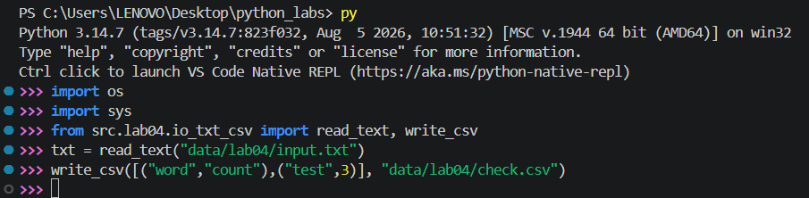

Результат:

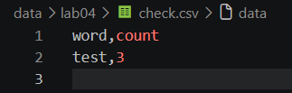

## Задание B - скрипт `src/lab04/text_report.py`

### Функция `frequencies_from_text`

**Код:**

```py
def frequencies_from_text(text: str) -> dict[str, int]:
    if type(text) != str: raise TypeError("This function works only with string")
    from lib.text import normalize, tokenize
    tokens = tokenize(normalize(text))
    return Counter(tokens)
```

### Функция `sorted_word_counts`

**Код:**

```py
def sorted_word_counts(freq: dict[str, int]) -> list[tuple[str, int]]:
    try:
        return sorted(freq.items(), key=lambda kv: (-kv[1], kv[0]))
    except:
        raise TypeError("This function works only with dictionary")
```

### Создание отчёта при чтении пустого файла

При чтении пустого файла отчёт содержит в себе только заголовок `word,count`. 

### Тест-кейсы

#### A. Один файл (база)

Вход (`data/lab04/input.txt`):

```txt
Привет, мир! Привет!!!
```

Вывод в `report.csv`:

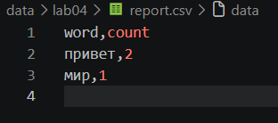

Вывод в консоль:

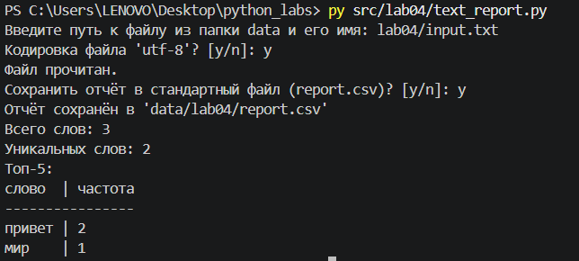

#### B. Пустой файл

Ввод: пустой файл `input.txt`

Вывод: `report.csv` только с заголовком

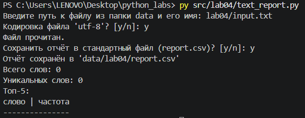

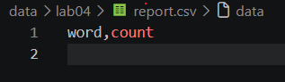

## Задание C - реализация работы скрипта `src/lab04/text_report.py` с помощью аргументов в командной строке

Это улучшение скрипта `src/lab04/text_report.py`, скрипт продолжает поддерживать работу в старом режиме

Для реализации используется библиотека `argparse`, которая парсит аргументы:

```py
import argparse
```

*Парсинг - процесс автоматического сбора и обработки данных.*

Документация к использованию - https://docs.python.org/3/library/argparse.html

### Настройка парсера аргументов

```py
parser = argparse.ArgumentParser(description="Генератор отчетов по тексту")
parser.add_argument("--in", dest="input_file", type=str, help="Путь к входному файлу")
parser.add_argument("--encoding", type=str, help="Кодировка файла")
parser.add_argument("--out", type=str, help="Название выходного файла")
args = parser.parse_args()
```

Во второй строке используется `dest="input_file"`, что указывает, под каким именем значение аргумента сохранится в объекте `args`. По умолчанию `argparse` берет имя переменной из названия самого флага. Но с аргументом `--in` возникает проблема: слово `in` является зарезервированным оператором в Python. Чтобы избежать синтаксическую ошибку, переменная принудительно переименована.

Аргумент `--out` необязателен, если ничего не введено, то программа сохранит отчёт в файл `report.csv`

### Тест-кейсы

Ввод: файл `input.txt` в кодировке `cp1251` со строкой `Привет`

Вывод: `report.csv`

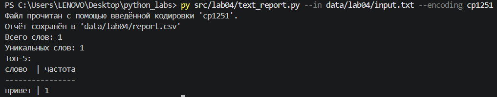

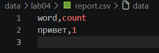

## Задание D (дополнительно) - несколько входных файлов и «сводный» отчёт

### Настройка парсера аргументов

Для данной задачи понадобилось немного изменить настройки

```py
parser = argparse.ArgumentParser(description="Генератор отчетов по тексту")
parser.add_argument("--in", dest="input_files", type=str, nargs="+", help="Пути к входным файлам через пробел")
parser.add_argument("--encoding", type=str, help="Кодировка всех файлов (одна и та же)")
parser.add_argument("--per-file", dest="per_file", type=str, help="Путь к файлу пофайлового отчёта")
parser.add_argument("--total", type=str, help="Путь к файлу сводного отчёта")
args = parser.parse_args()
```

Добавлен `nargs="+"` для поддержки списка файлов.

*Параметр `nargs` (сокращение от number of arguments) в библиотеке `argparse` определяет, сколько значений из командной строки должен забрать один флаг. По умолчанию аргумент принимает ровно одно значение.*

Аргументы `--per-file` и `--total` необязательны, если ничего не введено, то программа сохранит отчёты в файлы `report_per_file.csv` и `report_total.csv` соответственно.

### Изменения в остальном коде

Реализован цикл обработки файлов и раздельный экспорт отчётов
- Чтение данных: чтение одного файла заменено на итерацию по списку путей с индивидуальным определением кодировки для каждого документа.
- Накопление результатов разделено на две структуры данных - список `per_file_data` для сохранения контекста файлов и общий `Counter` для суммирования всех токенов.
- Сортировка и экспорт: настроена составная сортировка пофайлового списка (по имени файла, частоте, слову) и реализована раздельная запись в файлы `report_per_file.csv` и `report_total.csv`.

### Тест-кейсы

**Вход:**

`a.txt`: Привет мир

`b.txt`: Привет, привет!

**Запуск:**

`python src/lab04/text_report.py --in data/lab04/a.txt data/lab04/b.txt --per-file data/lab04/report_per_file.csv --total data/lab04/report_total.csv`

**Вывод:**

Консоль:

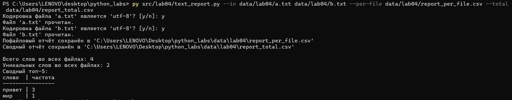

Пофайловый отчёт:

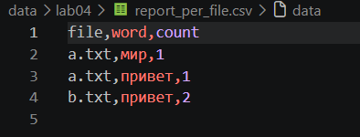

Сводный отчёт:

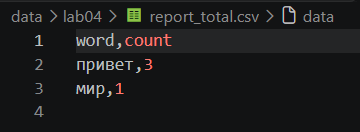