# JSON и конвертации (JSON↔CSV, CSV→XLSX)

**JSON (JavaScript Object Notation)** — текстовый формат для обмена структурированными данными.
Хранит объекты и списки, используется для сериализации и API.

**CSV (Comma-Separated Values)** — табличный текстовый формат, где значения разделены запятыми или `;`.

## Задание A — JSON ↔ CSV

### Тест-кейсы

**Тест 1**

`people.json` -> `people.csv`

Запуск и результат:

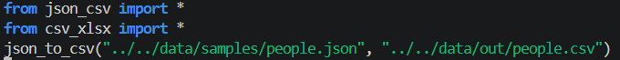

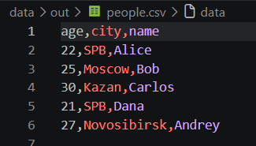

**Тест 2**

`people.csv` -> `people.json`

Запуск и результат:

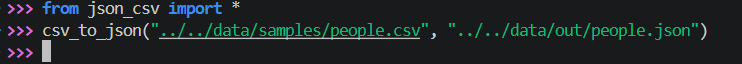

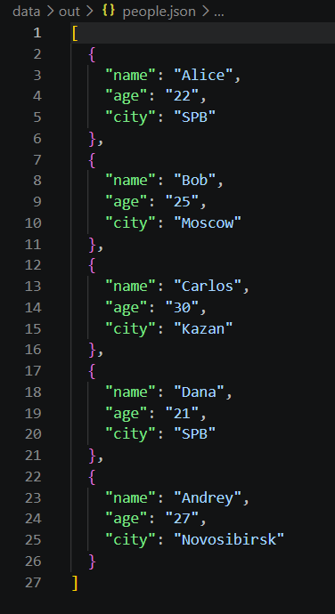

**Тест 3**

Пустой csv-файл 

Запуск и результат:

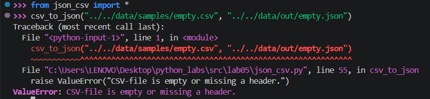

**Тест 4**

Пустой json-файл 

Запуск и результат:

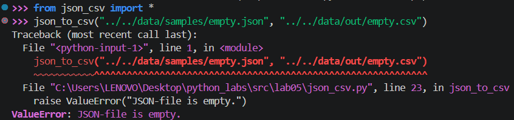

**Тест 5**

csv-файл только с заголовком  

Запуск и результат:

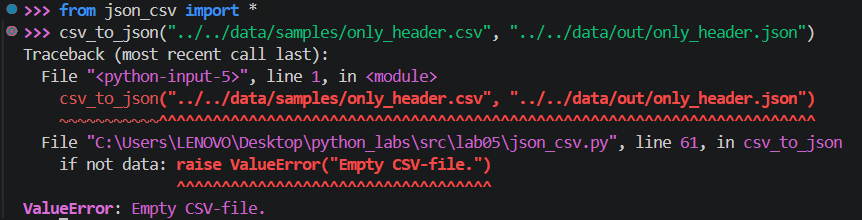

**Тест 6**

Не существующий csv-файл

Запуск и результат:

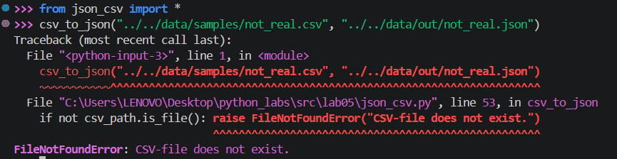

**Тест 7**

`phones.json` -> `csv.json`

Запуск 

## Задание B — CSV → XLSX

Для работы с `XLSX` используется `openpyxl`

### Работа с файлом XLSX

**Подготовка книги и сохранение:**
```py
wb = Workbook()
ws = wb.active
ws.title = "Sheet1"

# ...

wb.save(xlsx_path)
```

`active` открывает первую страницу (таблицу) из файла

### Размер колонок в файле XLSX

Для изменения размера колонок используется `get_column_letter` из `openpyxl.utils`

```py
from openpyxl.utils import get_column_letter
```

**Логика изменения размера колонок:**
```py
for col in ws.columns:
    max_len = max(len(str(cell.value or '')) for cell in col)
    col_letter = get_column_letter(col[0].column)
    ws.column_dimensions[col_letter].width = max(max_len + 1, 8)
```

`col_letter = get_column_letter(col[0].column)` - получает букву колонки

`ws.column_dimensions[col_letter].width = max(max_len + 1, 8)` - устанавливает ширину: максимум из длины текста (+ запас) или 8 - минимальный размер по ТЗ

### Тест-кейсы

**Тест 1**

`cities.csv` -> `cities.xlsx`

Запуск и результат:

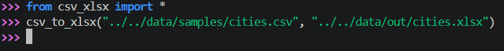

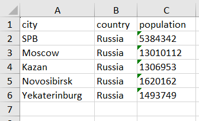

**Тест 2**

`exmple1.csv` -> `example1.xlsx`

Исходный файл:


Запуск:

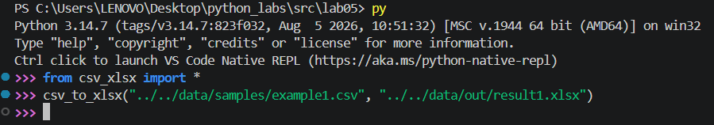

Результат:


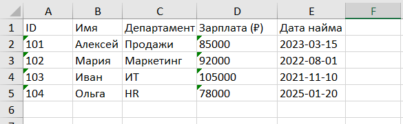