# CLI‑утилиты с argparse

Для реализации использовался модуль argspace - стандартный инструмент Python для парсинга аргументов командной строки.

```py
import argparse
```

## CLI обработчик текста

### Демонстрация

**Тест 1**

Исходный файл: [people.csv](../../data/samples/people.csv)

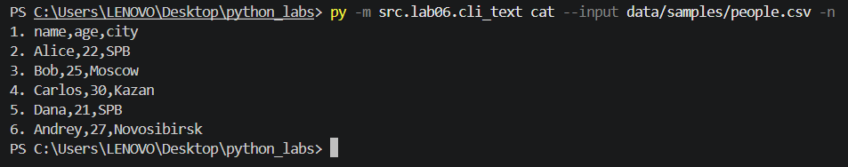

**Тест 2**

Исходный файл: [people.csv](../../data/samples/people.csv)

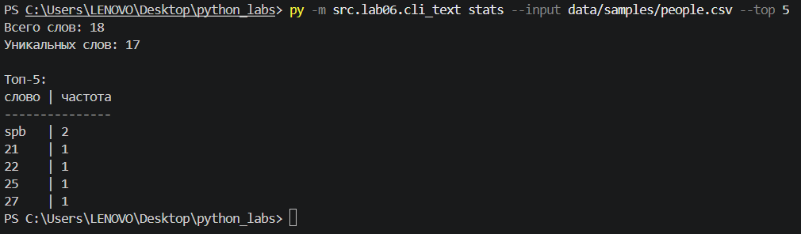

**Тест 3:**

Исходный файл: [input1.txt](../../data/samples/input1.txt)

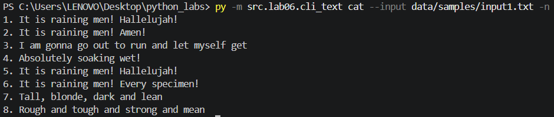

**Тест 4:**

Исходный файл: [input1.txt](../../data/samples/input1.txt)

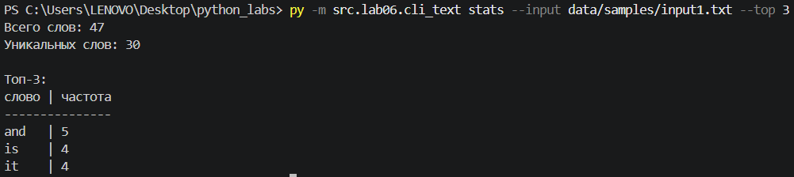

### Обработка ошибок

**Кейс 1: файл не существует**

Вызовы и ошибки:

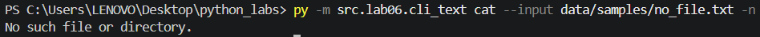

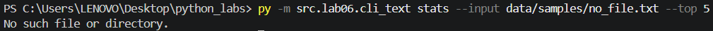

**Кейс 2: неверные аргументы**

Вызовы и ошибки:


### Справка

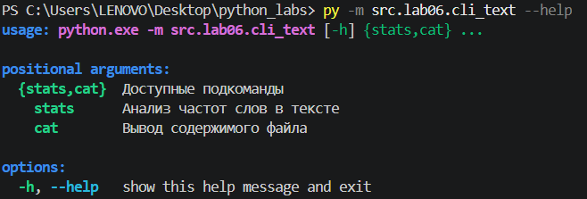

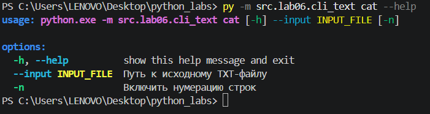

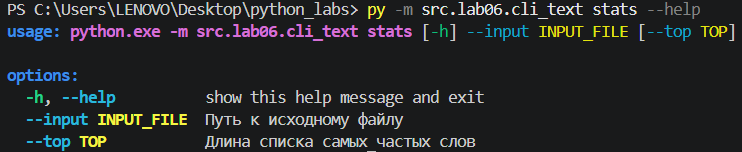

## CLI-конвертер

### Демонстрация

**Тест 1**

Вызов:

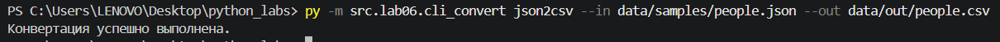

Исходный JSON-файл:
```json
[
  {
    "name": "Alice",
    "age": 22,
    "city": "SPB"
  },
  {
    "name": "Bob",
    "age": 25,
    "city": "Moscow"
  },
  {
    "name": "Carlos",
    "age": 30,
    "city": "Kazan"
  },
  {
    "name": "Dana",
    "age": 21,
    "city": "SPB"
  },
  {
    "name": "Andrey",
    "age": 27,
    "city": "Novosibirsk"
  }
]
```

Итог:

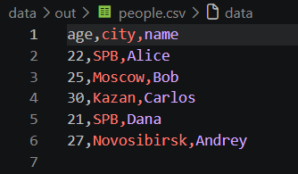

**Тест 2:**

Вызов:


Исходный CSV-файл:
```csv
```

Итог:


**Тест 3:**

Вызов:


Исходный CSV-файл:
```csv
```

Итог:


### Обработка ошибок

**Кейс 1: файл не существует**

Вызовы и ошибки:

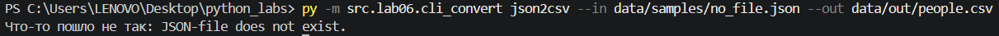

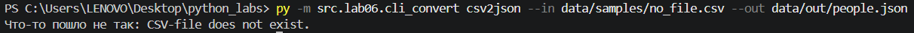

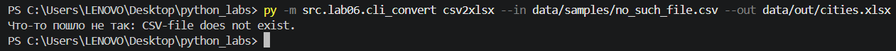

**Кейс 2: неверные аргументы**

Вызовы и ошибки:

### Справка

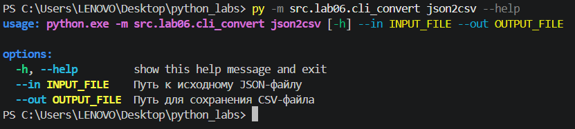

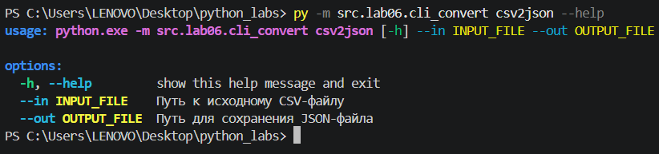

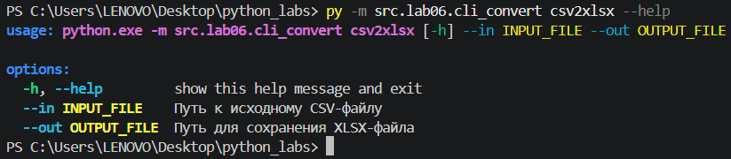