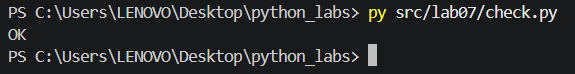
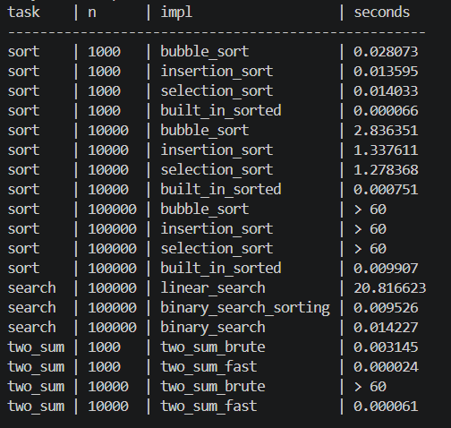

# Поиск, сортировка и измерение времени

Лабораторная работа №7 посвящена реализации базовых алгоритмов поиска и квадратичной сортировки своими руками, их верификации с помощью дифференциального тестирования против эталона, а также проведению бенчмарков времени выполнения на разных объёмах данных.

---

## Тестирование и верификация (`src/lab07/check.py`)

Для подтверждения корректности написанных алгоритмов реализовано автоматизированное тестирование с помощью механизма утверждений `assert`. Скрипт `check.py` сравнивает поведение самописных функций с эталонными встроенными инструментами языка Python (`sorted()` и `list.index()`) на 100 случайных генерациях тестовых массивов (включая крайние кейсы: пустые списки, дубликаты элементов и отрицательные числа).

### Результаты тестирования

При запуске верификации все алгоритмы успешно прошли тесты, не вызвав исключений `AssertionError`.

**Скриншот выполнения тестов:**

---

## Бенчмарк производительности (`src/lab07/bench.py`)

Замеры времени проводились с помощью встроенного модуля `timeit` на идентичных наборах данных (с фиксированным `random.seed(42)`). Сортировки использовали предгенерированные числовые сэмплы из папки `data/samples/lab07/`. Для квадратичных сортировок на размере $10^5$ элементов установлено временное ограничение.

### Таблица результатов бенчмарка

[bench.csv](../../data/lab07/bench.csv)

| task | n | impl | seconds |
| :--- | :--- | :--- | :--- |
| sort | 1000 | bubble_sort | 0.028073 |
| sort | 1000 | insertion_sort | 0.013595 |
| sort | 1000 | selection_sort | 0.014033 |
| sort | 1000 | built_in_sorted | 0.000066 |
| sort | 10000 | bubble_sort | 2.836351 |
| sort | 10000 | insertion_sort | 1.337611 |
| sort | 10000 | selection_sort | 1.278368 |
| sort | 10000 | built_in_sorted | 0.000751 |
| sort | 100000 | bubble_sort | > 60 |
| sort | 100000 | insertion_sort | > 60 |
| sort | 100000 | selection_sort | > 60 |
| sort | 100000 | built_in_sorted | 0.009907 |
| search | 100000 | linear_search | 20.816623 |
| search | 100000 | binary_search_sorting | 0.009526 |
| search | 100000 | binary_search | 0.014227 |
| two_sum | 1000 | two_sum_brute | 0.003145 |
| two_sum | 1000 | two_sum_fast | 0.000024 |
| two_sum | 10000 | two_sum_brute | > 60 |
| two_sum | 10000 | two_sum_fast | 0.000061 |

**Скриншот вывода бенчмарка в консоль:**

---

## Выводы по работе

1. **Анализ алгоритмов сортировки:** самописные алгоритмы (пузырёк, вставки, выбор) обладают квадратичной сложностью $O(n^2)$. При увеличении размера входного массива $n$ в 10 раз (с 1 000 до 10 000), количество внутренних операций и время выполнения закономерно возрастают примерно в 100 раз ($10^2$). На объёме в $10^5$ элементов они превышают допустимый лимит времени (> 60 с). Напротив, эталонный `sorted` имеет сложность $O(n \log n)$. При аналогичном десятикратном увеличении данных его время растёт всего в ~11-12 раз.
2. **Окупаемость предварительной сортировки:** бинарный поиск обладает логарифмической сложностью $O(\log n)$ и выполняется почти мгновенно, однако он строго требует предварительно отсортированного массива. Линейный поиск со сложностью $O(n)$ работает медленнее, но не накладывает ограничений на структуру данных. Предварительная сортировка массива ради бинарного поиска окупается в сценариях с высокой частотой запросов (многократный поиск по одной базе). В нашем тесте для 10 000 поисковых запросов суммарное время «сортировка + бинарный поиск» оказалось значительно меньше времени, затраченного на выполнение 10 000 последовательных линейных поисков.
3. **Эффективность подходов в Two Sum:** классический перебор пар (брутфорс) требует $O(n^2)$ шагов, что делает его неприменимым уже на массивах из 10 000 элементов. Оптимизированный подход с использованием хэш-таблицы (словаря `dict`) выполняет задачу за один проход со сложностью $O(n)$, снижая затраты времени с десятков секунд до тысячных долей секунды.

---