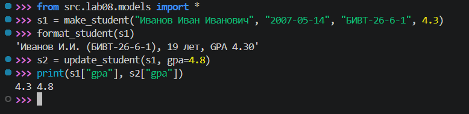
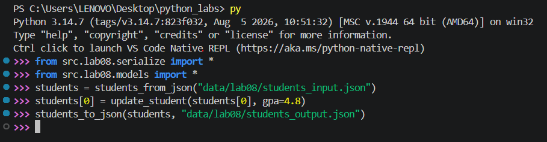

# Модель данных без классов: запись `Student` как словарь, валидация и сериализация

Для реализации использовались стандартные модули Python: `datetime` для работы с датами в формате ISO 8601, `json` для сериализации данных и `csv` для импорта табличных записей.

```py
from datetime import date
import json
import csv
```

---

## Задание A - модуль `src/lab08/models.py`

### Структура записи `Student`

Запись представлена словарём с фиксированным набором ключей, заданным в константе `STUDENT_FIELDS`:

```py
STUDENT_FIELDS = ("fio", "birthdate", "group", "gpa")
```

| Поле | Тип | Описание и ограничения |
| :--- | :--- | :--- |
| `fio` | `str` | ФИО студента, непустая строка (после `strip()`) |
| `birthdate` | `str` | Дата рождения в формате `YYYY-MM-DD`, дата существует и не находится в будущем |
| `group` | `str` | Учебная группа (например, `БИВТ-26-6-1`), непустая строка |
| `gpa` | `float` | Средний балл в диапазоне `0 ≤ gpa ≤ 5` (`int` приводится к `float`, `bool` запрещён) |

---

### Функция `make_student`

**Код:**

```py
def make_student(fio, birthdate, group, gpa) -> dict:
    rec = {
        STUDENT_FIELDS[0]: fio,
        STUDENT_FIELDS[1]: birthdate,
        STUDENT_FIELDS[2]: group,
        STUDENT_FIELDS[3]: float(gpa) if isinstance(gpa, int) and not isinstance(gpa, bool) else gpa
        }

    validate_student(rec)
    
    return rec
```

Собирает словарь с ключами из `STUDENT_FIELDS`, приводит целочисленный `gpa` к типу `float` и сразу передаёт запись в `validate_student` для проверки всех ограничений.

### Функция `validate_student`

**Код:**

```py
def validate_student(rec: dict) -> None:
    if not isinstance(rec, dict): raise TypeError("Recording type must be dictionary")

    if set(rec.keys()) != set(STUDENT_FIELDS): raise ValueError("Invalid set of write keys")

    if not isinstance(rec[STUDENT_FIELDS[0]], str):
        raise ValueError("The fio field must be a non-empty string")
    elif not rec[STUDENT_FIELDS[0]].strip():
        raise ValueError("The fio field must be a non-empty string")
    if not isinstance(rec[STUDENT_FIELDS[2]], str):
        raise ValueError("The group field must be a non-empty string")
    elif not rec[STUDENT_FIELDS[2]].strip():
        raise ValueError("The group field must be a non-empty string")
    if not isinstance(rec[STUDENT_FIELDS[1]], str):
        raise ValueError("The datebirth field must be a non-empty string")
    elif not rec[STUDENT_FIELDS[1]].strip():
        raise ValueError("The datebirth field must be a non-empty string")

    try: date.fromisoformat(rec[STUDENT_FIELDS[1]])
    except (ValueError, TypeError): raise ValueError("Wrong date format of birthdate (expects 'YYYY-MM-DD')")

    gpa = rec[STUDENT_FIELDS[3]]
    if isinstance(gpa, bool) or not isinstance(gpa, (int, float)):
        raise ValueError("gpa field must be a number")
    try: 0 <= float(gpa) <= 5
    except (ValueError, TypeError): raise ValueError("gpa field must be a number between 0 and 5")
```

`set(rec.keys()) != set(STUDENT_FIELDS)` - гарантирует, что в словаре присутствуют ровно 4 нужных ключа без лишних или пропущенных полей.

`date.fromisoformat()` - проверяет не только соответствие шаблону `YYYY-MM-DD`, но и реальное существование даты в календаре (например, отсекает `2003-02-30`).

`isinstance(gpa, bool)` - отдельная проверка необходима, так как в Python логический тип `bool` является подклассом `int` (`True == 1`, `False == 0`).

### Функция `student_age`

**Код:**

```py
def student_age(rec: dict, today=None) -> int:
    validate_student(rec)

    if today == None: today = date.today()
    elif isinstance(today, str): today = date.fromisoformat(today)
    else: raise ValueError("Wrong date format of today date (expects 'YYYY-MM-DD')")
    
    bdate = date.fromisoformat(rec[STUDENT_FIELDS[1]])
    if bdate.year > today.year: raise ValueError("Wrong birthdate date: year of birth later than today")
    age = today.year - bdate.year
    if (today.month, today.day) < (bdate.month, bdate.day): age -= 1

    return age
```

Сравнивает кортежи `(month, day)` текущей даты и даты рождения: если день рождения в текущем году ещё не наступил, из разницы годов вычитается `1`.

### Функция `format_student`

**Код:**

```py
def format_student(rec: dict) -> str:
    validate_student(rec)

    fio_parts = rec[STUDENT_FIELDS[0]].split()
    if len(fio_parts) >= 3: fio_form = f"{fio_parts[0]} {fio_parts[1][0]}.{fio_parts[2][0]}."
    elif len(fio_parts) == 2: fio_form = f"{fio_parts[0]} {fio_parts[1][0]}."
    else: fio_form = rec[STUDENT_FIELDS[0]]

    age = student_age(rec)
    if 11 <= age % 100 <= 19: years_str = "лет"
    elif age % 10 == 1: years_str = "год"
    elif age % 10 in (2, 3, 4): years_str = "года"
    else: years_str = "лет"

    gpa_val = float(rec[STUDENT_FIELDS[3]])

    return f"{fio_form} ({rec[STUDENT_FIELDS[2]]}), {age} {years_str}, GPA {gpa_val:.2f}"
```

Формирует строку вида `Иванов И.И. (БИВТ-26-6-1), 19 лет, GPA 4.30` с автоматическим сокращением имени и отчества до инициалов и склонением слова «год».

### Функции `student_to_dict` и `student_from_dict`

**Код:**

```py
def student_to_dict(rec: dict) -> dict:
    validate_student(rec)
    return {
        STUDENT_FIELDS[0]: rec[STUDENT_FIELDS[0]],
        STUDENT_FIELDS[1]: rec[STUDENT_FIELDS[1]],
        STUDENT_FIELDS[2]: rec[STUDENT_FIELDS[2]],
        STUDENT_FIELDS[3]: rec[STUDENT_FIELDS[3]]
    }

def student_from_dict(d: dict) -> dict:
    if not isinstance(d, dict): raise ValueError("Works only with dictionary")

    extracted = {}
    for field in STUDENT_FIELDS:
        if field not in d: raise ValueError(f"There is no required field: {field}")
        extracted[field] = d[field]

    try: extracted[STUDENT_FIELDS[3]] = float(extracted[STUDENT_FIELDS[3]])
    except (ValueError, TypeError): raise ValueError("Failed to cast gpa to float")
    
    validate_student(extracted)
    
    return extracted
```

---

## Задание B - модуль `src/lab08/serialize.py`

### Функции `students_to_json` и `students_from_json`

**Код:**

```py
def students_to_json(students: list[dict], path: str | Path) -> None:
    data = [student_to_dict(s) for s in students]
    ensure_parent_dir(path)
    with open(path, "w", encoding="utf-8") as f:
        json.dump(data, f, ensure_ascii=False, indent=2)

def students_from_json(path: str | Path) -> list[dict]:
    try:
        with open(path, "r", encoding="utf-8") as f:
            raw_data = json.load(f)
    except FileNotFoundError:
        raise FileNotFoundError(f"The file at path {path} was not found or does not exist.")
    except Exception as e:
        raise f"Error: {e}"
    
    if not isinstance(raw_data, list):
        raise ValueError("The root element of the JSON must be an array.")

    valid_students = []
    skipped_errors = []

    for idx, item in enumerate(raw_data, start=1):
        try:
            student = student_from_dict(item)
            valid_students.append(student)
        except ValueError as e:
            skipped_errors.append(f"Recording №{idx}: {e}")

    if skipped_errors:
        print(f"Missed broken records: {len(skipped_errors)}")
        for err in skipped_errors:
            print(f"  - {err}")

    return valid_students
```

`ensure_ascii=False` - сохраняет кириллицу в читаемом виде.

### Политика обработки битых записей (`skip`)

При чтении списка студентов в `students_from_json` выбрана политика **`skip`**:
- Каждая запись из JSON-массива проходит проверку через `student_from_dict`.
- При обнаружении некорректной записи (неверный формат даты, выход `gpa` за пределы `0..5`, отсутствие нужных ключей) исключение `ValueError` перехватывается, а сама запись пропускается.
- После завершения чтения файла в консоль выводится итоговое количество пропущенных записей и подробный список причин с указанием порядкового номера каждой битой записи.

---

## Задание ★ (дополнительно)

### Функция `update_student` в `models.py`

**Код:**

```py
def update_student(rec: dict, **fields) -> dict:
    for key in fields:
        if key not in STUDENT_FIELDS:
            raise KeyError(f"Unknown field to update: {key}")

    new_rec = {
        STUDENT_FIELDS[0]: rec[STUDENT_FIELDS[0]],
        STUDENT_FIELDS[1]: rec[STUDENT_FIELDS[1]],
        STUDENT_FIELDS[2]: rec[STUDENT_FIELDS[2]],
        STUDENT_FIELDS[3]: rec[STUDENT_FIELDS[3]]
    }

    new_rec.update(fields)
    validate_student(new_rec)

    return new_rec
```

Принимает произвольные именованные аргументы через `**fields`. Если передан ключ, отсутствующий в `STUDENT_FIELDS`, выбрасывается `KeyError`. Изменения применяются к копии словаря, после чего обновлённая запись проверяется через `validate_student`. Исходный словарь остаётся без изменений.

### Функция `students_from_csv` в `serialize.py`

**Код:**

```py
def students_from_csv(path: str | Path) -> list[dict]:
    try:
        with open(path, "r", encoding="utf-8", newline="") as f:
            reader = csv.DictReader(f)
    except FileNotFoundError:
        raise FileNotFoundError(f"The file at path {path} was not found or does not exist.")
    except Exception as e:
        raise f"Error: {e}"
    
    valid_students = []
    skipped_errors = []

    if reader.fieldnames is None or not set(STUDENT_FIELDS).issubset(set(reader.fieldnames)):
        raise ValueError(f"Required headers are missing from the CSV. Expected: {', '.join(STUDENT_FIELDS)}")

    for row_num, row in enumerate(reader, start=2):
            try:
                student = student_from_dict(row)
                valid_students.append(student)
            except ValueError as e:
                skipped_errors.append(f"Recording №{row_num}: {e}")

    if skipped_errors:
        print(f"Missed broken records: {len(skipped_errors)}")
        for err in skipped_errors:
            print(f"  - {err}")

    return valid_students
```

**Где решается проблема строкового `gpa` при чтении из CSV:**
`csv.DictReader` считывает значения всех ячеек как строки (`str`), поэтому поле `gpa` поступает в виде строки (например, `"4.30"`). Преобразование типа выполняется внутри функции **`student_from_dict(row)`**, через которую проходит каждая строка CSV: строка `extracted[STUDENT_FIELDS[3]] = float(extracted[STUDENT_FIELDS[3]])` принудительно переводит значение в число с плавающей точкой до вызова `validate_student`.

Битые записи обрабатываются аналогично тому, как это происходит в функции `students_from_json`.

---

## Демонстрация работы

### Тест 1: создание, форматирование и обновление записей (`models.py`)



### Тест 2: корректные записи JSON туда-обратно (`serialize.py`)

Исходный файл: [students_input.json](../../data/lab08/students_input.json)

Вызов:



Выходной файл: [students_output.json](../../data/lab08/students_output.json)

### Тест 3: чтение из CSV (`students_from_csv` в `serialize.py`)

---

## Обработка ошибок

### Кейс 1: запись с неверной датой (2003-02-30 и дата в будущем)

### Кейс 2: запись с некорректным gpa

1. Выход за диапазон

2. Недопустимый тип для gpa

### Кейс 3: чтение файла с битыми записями (`students_bad.json`, политика `skip`)

Файл: [students_bad.json](../../data/lab08/students_bad.json)