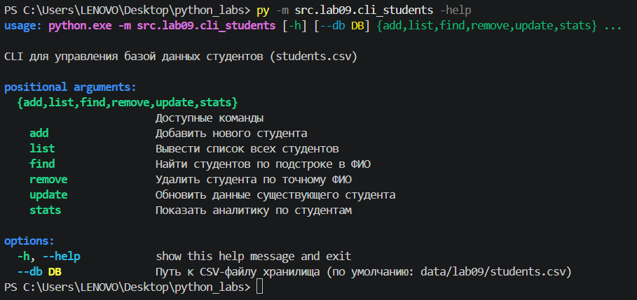

# «База данных» на CSV: CRUD-функции над `students.csv` и CLI

**CRUD** - это акроним, обозначающий четыре базовые операции для работы с данными в любом хранилище или базе данных: **Create** (создание), **Read** (чтение), **Update** (обновление) и **Delete** (удаление).

Для реализации использовались стандартные модули Python: `csv` для чтения и записи табличных записей, `pathlib` для работы с путями к файлам, `argparse` для создания консольной утилиты, а также функции валидации и форматирования из `src/lab08/models.py`.

```py
import csv
from pathlib import Path
import argparse
```

---

## Задание A - модуль `src/lab09/group.py`

Модуль реализует работу с CSV-хранилищем по схеме «загрузить → изменить → сохранить» без использования классов - каждая функция принимает путь к файлу `path` первым аргументом.

### Служебные функции хранилища

| Функция | Назначение |
| :--- | :--- |
| `ensure_storage(path)` | Создаёт недостающие каталоги и пустой CSV-файл с заголовком `fio,birthdate,group,gpa`, если файл ещё не существует |
| `load_students(path)` | Считывает записи через `csv.DictReader`, проверяет совпадение заголовка с `STUDENT_FIELDS`, отсутствие лишних колонок и валидирует каждую строку через `student_from_dict` |
| `save_students(path, students)` | Перезаписывает CSV-файл целиком через `csv.DictWriter` (`newline=""`, `encoding="utf-8"`) |

**Проблема строкового `gpa` при чтении из CSV:**
`csv.DictReader` считывает все значения из файла как строки (`str`), из-за чего прямое сравнение вида `"4.3" > "10.0"` работало бы некорректно (по алфавиту). Приведение `gpa` к типу `float` выполняется автоматически внутри `student_from_dict(row)` при загрузке данных в `load_students`.

### CRUD-операции

* **`add_student(path, student)`** - валидирует словарь через `validate_student`, нормализует типы через `student_from_dict` и дописывает студента в конец хранилища.
* **`list_students(path, sort_by=None)`** - возвращает список всех студентов; поддерживает сортировку по `"fio"` (без учёта регистра) или `"gpa"` (по убыванию), при неизвестном значении `sort_by` выбрасывает `ValueError`.
* **`find_students(path, substr)`** - возвращает список всех студентов, у которых подстрока `substr` входит в `fio` без учёта регистра.
* **`remove_student(path, fio)`** - удаляет все записи с точным совпадением `fio` и возвращает количество удалённых строк.
* **`update_student(path, fio, **fields)`** - обновляет переданные поля первой найденной записи с указанным `fio`; при передаче неизвестного ключа выбрасывает `KeyError`, а обновлённую запись проверяет через `validate_student`.

---

## Задание B - CLI-утилита `src/lab09/cli_students.py`

Консольная утилита на базе `argparse` с общим параметром `--db` (по умолчанию `data/lab09/students.csv`) и подкомандами `add`, `list`, `find`, `remove`, `update`, `stats`.

* Вывод записей выполняется построчно через `format_student` из ЛР8.
* Ошибки валидации и работы с файлами выводятся в `sys.stderr`, программа завершается с кодом возврата `1`.

---

## Задание ★ - аналитика по группе (`stats`)

В `group.py` добавлена функция `stats(path) -> dict`, а в `cli_students.py` - подкоманда `stats`, выводящая общую сводку по базе: общее количество студентов, минимальный, максимальный и средний `gpa`, распределение студентов по группам и топ-5 студентов по успеваемости.

---

## Демонстрация работы (сценарий команд)

Последовательный сценарий работы с хранилищем `data/lab09/students.csv`:

```bash
# 1. Добавление студентов
py -m src.lab09.cli_students add --fio "Иванов Иван" --birthdate "2007-10-10" --group "БИВТ-26-6-1" --gpa 4.3
py -m src.lab09.cli_students add --fio "Петрова Анна" --birthdate "2007-05-14" --group "БИВТ-26-6-2" --gpa 4.9
py -m src.lab09.cli_students add --fio "Сидоров Максим" --birthdate "2006-11-22" --group "БИВТ-26-6-1" --gpa 3.8

# 2. Вывод списка без сортировки и с сортировкой по GPA
py -m src.lab09.cli_students list
py -m src.lab09.cli_students list --sort gpa

# 3. Поиск по подстроке в ФИО (без учёта регистра)
py -m src.lab09.cli_students find --q "иван"

# 4. Обновление среднего балла студента
py -m src.lab09.cli_students update --fio "Иванов Иван" --gpa 4.6

# 5. Вывод аналитики по группе (задание ★)
py -m src.lab09.cli_students stats

# 6. Удаление записи
py -m src.lab09.cli_students remove --fio "Сидоров Максим"
```

### Тест 1: добавление записей (`add`)


### Тест 2: вывод списка без сортировки и с сортировкой (`list`)


### Тест 3: поиск, обновление и удаление записей (`find`, `update`, `remove`)


### Тест 4: аналитика по группе (`stats`)


### Итоговый файл `students.csv`

Файл: [students.csv](../../data/lab09/students.csv)

---

## Обработка ошибок

### Кейс 1: попытка добавить запись с неверным `gpa` (выход за диапазон `0..5`)

Вызов:
```bash
py -m src.lab09.cli_students add --fio "Тестов Тест" --birthdate "2007-01-01" --group "БИВТ-26-6-1" --gpa 9.9
```


### Кейс 2: попытка добавить запись с некорректной датой рождения

Вызов:
```bash
py -m src.lab09.cli_students add --fio "Тестов Тест" --birthdate "2007-02-30" --group "БИВТ-26-6-1" --gpa 4.0
```


### Кейс 3: команда `update` без указания обновляемых полей

Вызов:
```bash
py -m src.lab09.cli_students update --fio "Иванов Иван"
```


---

## Справка CLI

```bash
    py -m src.lab09.cli_students --help
```

